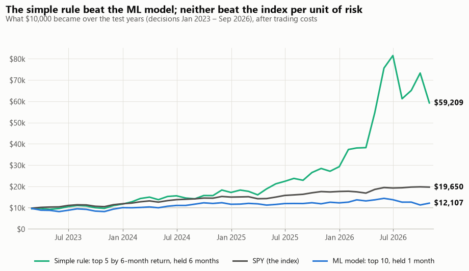
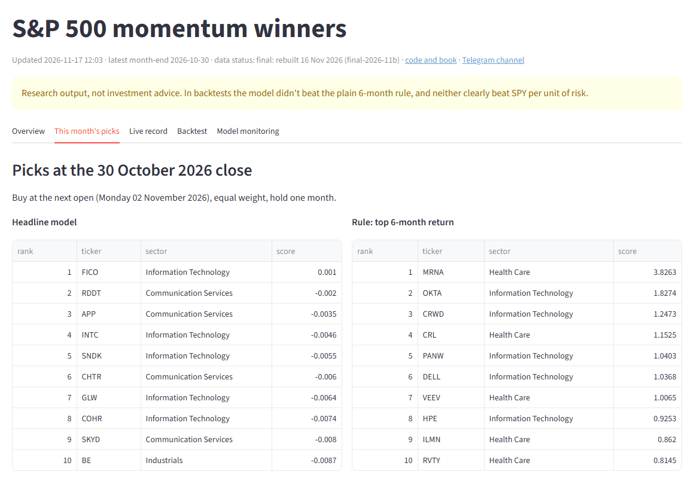

# S&P 500 Momentum Winners

### Does buying the stock market's recent winners beat simply holding the index? And can machine learning pick them better?

## The project

Momentum, the idea that rising stocks keep rising for a while, is easy to test badly: today's
S&P 500 holds only the survivors. This project rebuilds who was *actually* in the index each month
since 2010, then tests a simple "buy what went up" rule against a machine-learning model, chosen on
2010–2022 and judged once on 2023–2026.

## The findings

- **The simple rule won on money:** $10,000 became **$59,209**, against $19,650 in SPY (a fund
  that tracks the S&P 500).
- **Not on risk:** it swung almost four times as much; per unit of risk it only tied SPY.
- **The machine-learning model lost to both:** $10,000 became **$12,107**.
- **A caveat:** most of the rule's gain came from a handful of AI and memory-chip stocks in one
  burst in late 2025 and 2026, a theme it caught rather than a steady edge, and 45 months is a
  short test.

| $10,000 over the test years (2023–2026, 45 months, after costs) | Became | Sharpe ratio* | Worst fall |
| --- | --- | --- | --- |
| SPY, the index | $19,650 | 1.21 | −8% |
| **Simple rule:** top 5 by 6-month return, each held 6 months | **$59,209** | 1.21 | −27% |
| **ML model:** top 10 by predicted return above SPY, each held 1 month | $12,107 | 0.12 | −22% |

\*Return per unit of risk: higher is better.

[Chapter 9](docs/09_results.md) has the full results; [Chapter 10](docs/10_lessons.md) explains why.

## Explore

### Read

- **[The project book](https://siddharthps.github.io/sp500-momentum-winners/)**: every step as a short
  chapter, in plain words. Start with [Chapter 1](docs/01_problem.md), or go straight to
  [the results](docs/09_results.md).

### See it live

- **[Live dashboard](https://sp500-momentum-winners.streamlit.app/)** (may take a minute to wake
  up): this month's top 10 from the model and from the 6-month rule, each held one month so the
  two compete like for like (the rule in the table above isn't tracked live), the live record
  (from January 2027), the backtest and model monitoring.
- **[Monthly picks on Telegram](https://t.me/s/sp500_momentum_picks)**: posted the night after each
  month's last close; readable in a browser, no account needed.

### Use the data

- **[Public dataset on Hugging Face](https://huggingface.co/datasets/siddharthps/sp500-momentum-winners)**:
  the features, model scores, picks and results (without the vendors' raw prices).
- **Docker image** `ghcr.io/siddharthps/sp500-momentum-winners`: the tested environment, ready to
  run.

### Follow the work

- [Issues](https://github.com/siddharthps/sp500-momentum-winners/issues),
  [milestones](https://github.com/siddharthps/sp500-momentum-winners/milestones) and the
  [project board](https://github.com/users/siddharthps/projects/1); every decision and its reason in
  the [decision log](references/decisions.md).

## Run it yourself

Needs [uv](https://docs.astral.sh/uv/) and Python 3.12; `uv sync` installs everything. The
[notebooks](notebooks/) are committed with their outputs, so the analysis can be read without
running anything. A full rebuild from the sources needs free FRED and Alpha Vantage keys (Alpha
Vantage's free tier took twelve nights of daily pulls). The **[running guide](docs/running.md)**
has every step, from the raw data to the monthly run.

## Acknowledgements

This project was built as the final project for the
[Stock Markets Analytics Zoomcamp 2026](https://github.com/DataTalksClub/stock-markets-analytics-zoomcamp),
run by [DataTalks.Club](https://datatalks.club/).

Special thanks to **Ivan Brigida**, who hosted the course. Its step-by-step path from raw market data
to features, models and trading simulations gave this project its shape, and much of the workflow
here (named feature sets, prediction rules, the simulation) follows the one the course taught.

Thanks also to **Alexey Grigorev** for running DataTalks.Club, and to its community, which makes
courses like this one possible.
