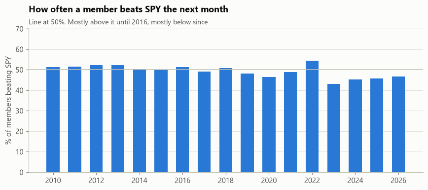
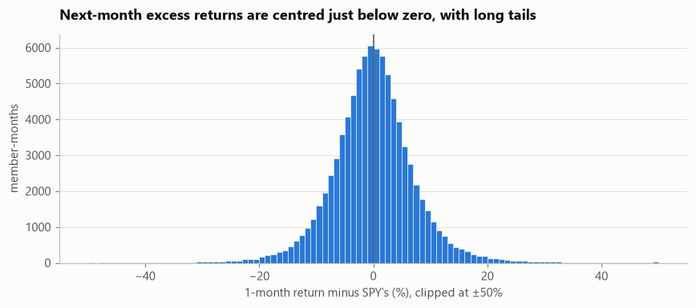
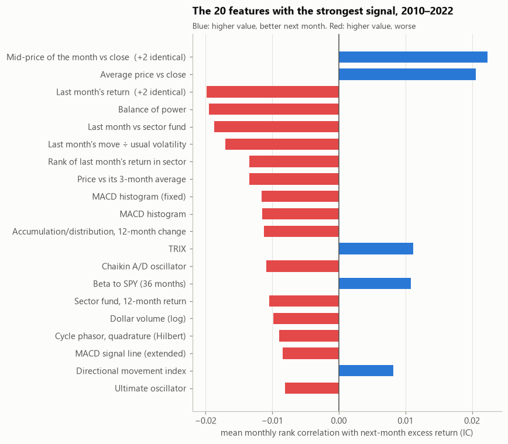
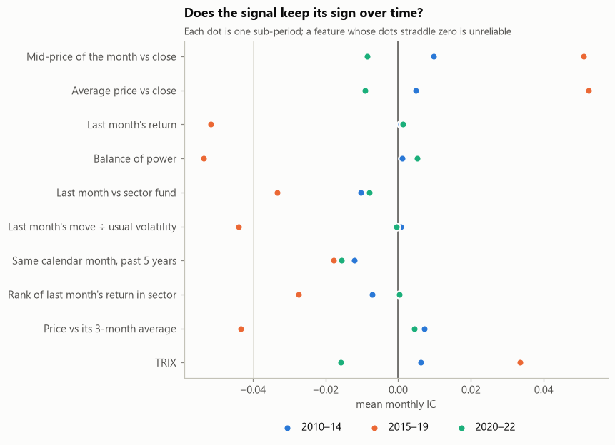
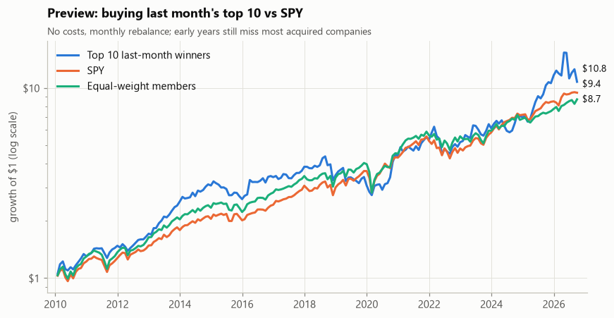

# Chapter 5: Exploratory analysis

## 1. Goal

Before building any model, understand the two sides of the problem:

1. **The target.** How often does an S&P 500 member beat SPY over the next month, and how spread out
   are the results?
2. **The features.** Which of the 152 carry any signal about next month, is that signal steady, and
   does it depend on market conditions?

It also takes a first look at the plain rule ("buy last month's winners"), as a preview.

> **All numbers here are previews.** The download of delisted companies is still running, so the early
> years still miss many acquired companies. Everything gets rerun once it's complete.

---

## 2. What was done

| Step | What it answers |
| --- | --- |
| 1 | The share of members beating SPY, year by year, and the spread of excess returns |
| 2 | Each feature's **information coefficient (IC)**: within each month, how well it ranks next month's winners |
| 3 | Whether that signal keeps its sign across three stretches of time |
| 4 | Which features are just copies of each other |
| 5 | Whether last month's winners do better in some market conditions than others |
| 6 | A first look at the plain rule against SPY and an equal-weight basket |

**One rule applies to steps 2–5.** They use decisions from **2010 to 2022 only**. The last four years
are kept back as the test period. If the features were chosen by looking at how they did there, the
final test would only be checking what had already been seen. Describing the target, and the
plain-rule preview, cover every year: they choose nothing.

---

## 3. What came out

### 3.1 Beating SPY is harder than it sounds

| Period | Share of members beating SPY the next month |
| --- | --- |
| 2010–2016 | 50–52% |
| 2017–2021 | 46–51% |
| 2022 | 54% |
| 2023–2026 | 43–47% |

SPY is weighted by size, so in years when a few giants lead, most members trail it. Over all years,
**49%** of member-months beat SPY: the target is close to a coin flip.

The median member-month ends level with SPY (−0.1%), but the tails are wide: one month in twenty, a
member trails or beats SPY by about 11.5% or more (±45% over 12 months). Picking the right handful
matters more than the average.

### 3.2 No single feature predicts next month's winners strongly

The **information coefficient (IC)** is the rank correlation, within one month, between a feature
and next month's returns, averaged over all months. Stock-picking signals are small: an IC of
0.02–0.05, held steadily, is useful. The best here reach about **0.02**, and none is statistically
clear on its own.

**Last month's return points the wrong way** (IC −0.019): last month's winners did slightly worse
the next month, the short-term reversal known from research. The strongest features (where the close
sits in the month's range, balance of power) say the same thing: they favour stocks that closed the
month weakly.

**25 pairs** of features correlate above 0.95 (including three since removed, Chapter 4), so the
chart shows each distinct signal once.

### 3.3 The signal isn't steady

Almost all the signal is in **2015–2019** (IC around ±0.05). Before and after it's near zero, and
some features flip sign, so no single feature can be trusted alone: the models combine features and
are tuned across many successive years.

### 3.4 Last month's winners do better in strong markets

On average, the top 10 by last month's return do **no better** than the other members the following
month: a spread of +0.01% a month, positive in 53% of months. But the spread moves with market
conditions:

| Market condition at the decision | Correlation with the winners' next-month spread |
| --- | --- |
| SPY's return over the past 12 months | **+0.26** |
| SPY's return over the past 6 months | +0.24 |
| The sector fund's 12-month return | +0.21 |
| Share of members in an uptrend (breadth) | +0.19 |
| Fed Funds rate | **−0.20** |
| One-year Treasury yield | −0.17 |

Over 156 months, a correlation of 0.26 is about three standard errors from zero. But the 12-month
market returns overlap from one month to the next, so there are far fewer truly independent months
than 156: the pattern is suggestive, not proof. Winners kept winning more often after strong markets,
when most stocks were rising, and less often when interest rates were high. That motivated testing a
market-trend filter ([Chapter 7](07_simulation.md)). In the end it lowered risk-adjusted returns, and
it wasn't adopted.

### 3.5 A first look at the plain rule

Each month-end, buy last month's top 1, 5 or 10 members in equal amounts, and sell a month later.
There are no trading costs yet, and only this one hold period:

| | Yearly return | Volatility | Worst fall | Sharpe ratio |
| --- | --- | --- | --- | --- |
| Top 1 | 8.3% | 40.3% | −62% | 0.40 |
| Top 5 | 14.2% | 25.7% | −40% | 0.65 |
| **Top 10** | **15.6%** | 22.1% | −38% | 0.77 |
| SPY | 14.3% | 14.8% | −23% | 0.98 |
| Equal-weight members | 13.8% | 16.1% | −30% | 0.89 |

The top 10 beat SPY by about a point a year, with half again the volatility and a deeper worst fall:
**adjusted for risk, SPY was better.** The single best stock did worst of all. This fits the negative
IC: last month's winners are volatile stocks that rise with a rising market, which 2010–2026 mostly
was.

---

## 4. Decisions and why

| Decision | Why |
| --- | --- |
| Each distinct signal reported once | Exact copies would overstate how much independent information there is |
| Market conditions studied separately from stock features | A value shared by every stock in a month can't rank stocks, but it can change *which* stocks win |
| Risk shown next to return | A higher return bought with much more risk isn't a better strategy |

---

## 5. Caveats

- **Previews only.** The early years still miss many acquired companies. Takeover targets are often
  last month's winners, so the plain-rule numbers are likely to change.
- **The plain rule here has no trading costs** and uses one hold period. The full test of look-backs,
  hold periods, costs and benchmarks comes in [Chapter 7](07_simulation.md).
- **The Sharpe ratio here ignores the risk-free rate,** which flatters all strategies equally. The final
  results include it.
- **An IC averages over all members.** A feature can have a small average IC and still pick a useful
  handful of stocks at the extremes. The models are scored on their top picks for that reason.
