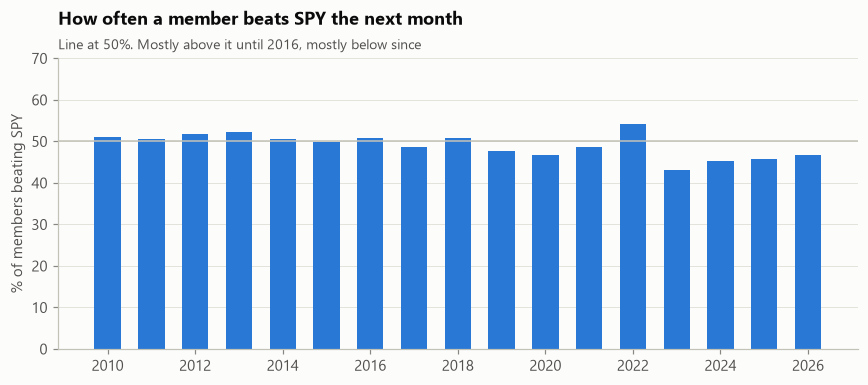
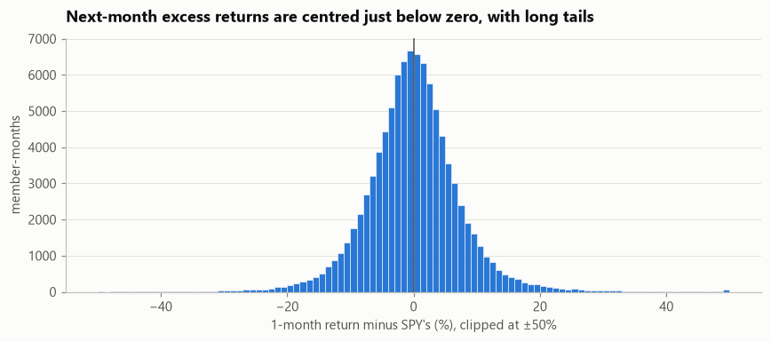
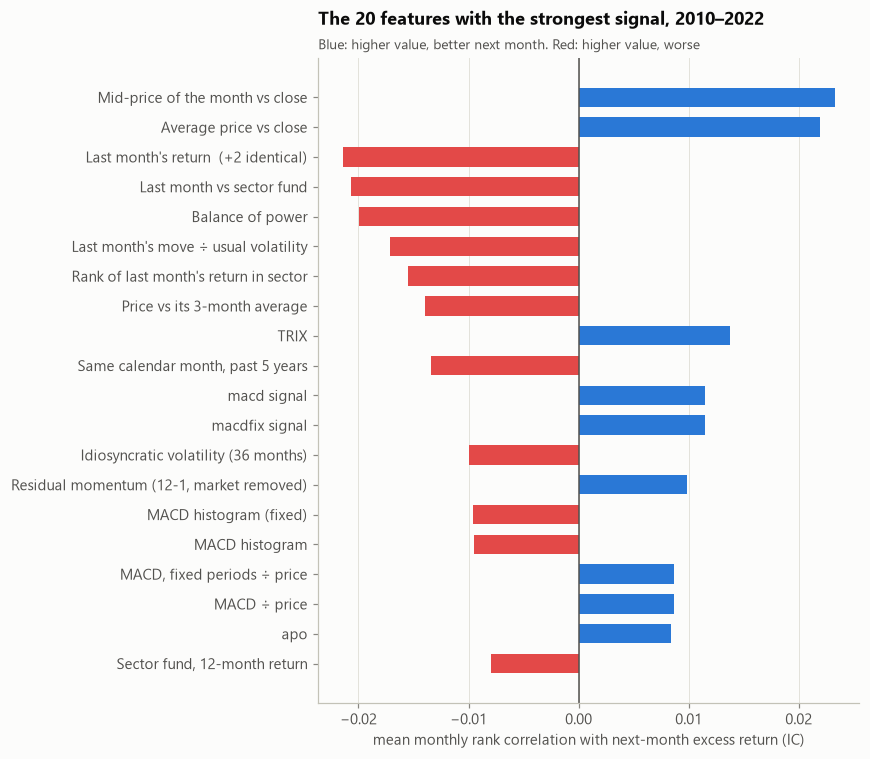
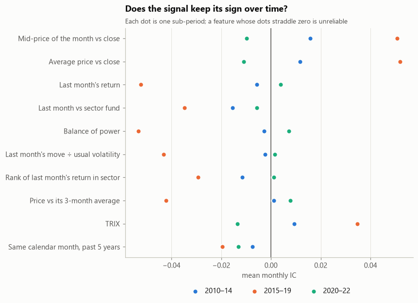
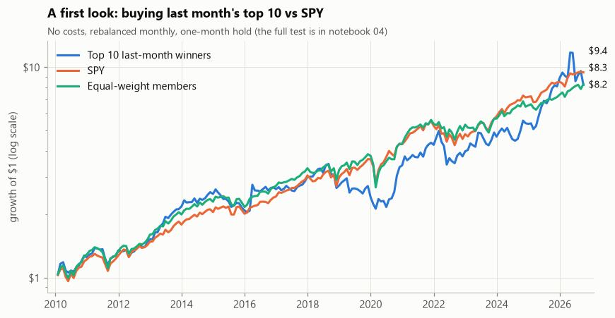

# Chapter 5: Exploratory analysis

## 1. Goal

Before building any model, understand the two sides of the problem:

1. **The target.** How often does an S&P 500 member beat SPY over the next month, and how spread out
   are the results?
2. **The features.** Which of the 147 carry any signal about next month, is that signal steady, and
   does it depend on market conditions?

It also takes a first look at the plain rule ("buy last month's winners").

---

## 2. What was done

| Step | What it answers |
| --- | --- |
| 1 | The share of members beating SPY, year by year, and the spread of excess returns |
| 2 | Each feature's **information coefficient (IC)**: within each month, how well it ranks next month's winners |
| 3 | Whether that signal keeps its sign across 2010–14, 2015–19 and 2020–22 |
| 4 | Which features are just copies of each other |
| 5 | Whether last month's winners do better in some market conditions than others |
| 6 | A first look at the plain rule against SPY and an equal-weight basket |

**Steps 2–5 use decisions from 2010 to 2022 only.** Decisions from 2023 on are kept back as the
test period: features chosen by how they did there would leave the final test checking what had
already been seen. Steps 1 and 6 cover every year, because they choose nothing.

---

## 3. What came out

### 3.1 Beating SPY is harder than it sounds

| Period | Share of members beating SPY the next month |
| --- | --- |
| 2010–2016 | 50–52% |
| 2017–2021 | 47–51% |
| 2022 | 54% |
| 2023–2026 | 43–47% |

(2026 covers decisions from January to September, the last with a known next month.)

SPY is weighted by size, so in years when a few giants lead, most members trail it. Over all years,
**49%** of member-months beat SPY: the target is close to a coin flip.

The median member-month ends level with SPY (−0.15%), but the tails are wide: one member-month in
twenty trails SPY by 11.5% or more, and another one in twenty beats it by as much (about 44% each
way over 12 months). Picking the right handful matters more than the average.

### 3.2 No single feature predicts next month's winners strongly

The **information coefficient (IC)** is the rank correlation, within one month, between a feature
and next month's returns, averaged over all months.

- **87 of the 147 features get an IC:** those that vary between stocks on the same date. Most of
  the other 60 are the same for every stock (the market, the economy, breadth) or only on or off
  (the flags).
- **The best signals are small.** The best here reach an IC of about **0.02**.
- **None is statistically clear on its own.** The strongest is about two standard errors from zero:
  borderline even for a single test, and 87 features were tested.

**Last month's return points the wrong way** (IC −0.021): last month's winners did slightly worse
the next month. Research has documented this one-month reversal since Jegadeesh (1990), and finds
it concentrated in illiquid stocks. S&P 500 members are among the most liquid, which fits the weak
reversal seen here. The strongest features say the same thing: they favour stocks that closed the month
weakly. They are where the close sits in the month's range, and balance of power (the month's
open-to-close move as a share of its high–low range).

The chart merges features that rank stocks identically, such as a return and its rank: the 87
features with an IC make 79 distinct signals. Near-copies still show separately: 17 pairs correlate
above 0.95, most of them in the MACD family.

### 3.3 The signal isn't steady

Almost all the signal is in **2015–2019** (IC up to about ±0.05). Before and after it's near zero,
and some features flip sign, so no single feature can be trusted alone: the models combine features
and are tuned across many successive years.

### 3.4 Last month's winners do better in strong markets

On average, the top 10 by last month's return do **slightly worse** than the average member the
following month: a spread of −0.15% a month, positive in 49% of months. But the spread moves
with market conditions. The strongest of the 34 market-wide conditions tried (the Dow's returns,
which track SPY's, are left out):

| Market condition at the decision | Correlation with the winners' next-month spread |
| --- | --- |
| SPY's return over the past 6 months | **+0.28** |
| SPY's return over the past 12 months | +0.24 |
| Share of members in an uptrend (breadth) | +0.21 |
| Oil's return over the past 6 months | +0.18 |
| Spread between the best and worst members | −0.15 |
| Fed Funds rate | −0.14 |
| 1-year Treasury yield | −0.13 |
| SPY's return over the past 3 months | +0.13 |

Over 156 months, a correlation of 0.28 is about three and a half standard errors from zero. Two
things weaken that, so the pattern is suggestive, not proof:

- it's the largest of 34 tried;
- the 6- and 12-month market returns overlap from one month to the next, so there are far fewer
  truly independent months than 156.

Winners kept winning more often after strong markets, when most stocks were rising. That motivated
testing a market-trend filter ([Chapter 7](07_simulation.md)), declared in advance as a reported
test, not a candidate. It helped most strategies in 2020–2022, which held a long decline, and hurt
everywhere else.

### 3.5 A first look at the plain rule

Each month-end from January 2010 to September 2026 (201 decisions), buy last month's top 1, 5 or
10 members in equal amounts, and sell a month later. There are no trading costs yet, and only this
one hold period:

| | Yearly return | Volatility | Worst fall | Sharpe ratio |
| --- | --- | --- | --- | --- |
| Top 1 | 6.3% | 41.5% | −62% | 0.36 |
| Top 5 | 12.0% | 27.2% | −44% | 0.55 |
| **Top 10** | **13.4%** | 22.9% | −39% | 0.67 |
| SPY | 14.3% | 14.8% | −23% | 0.98 |
| Equal-weight members | 13.5% | 16.1% | −30% | 0.87 |

**Last month's winners trailed SPY even before costs:** the top 10 earned 13.4% a year against
14.3%, with half again the volatility and a deeper worst fall. The fewer stocks, the worse: the
single best stock did worst of all. That fits the negative IC: last month's winners tend to fall
back.

---

## 4. Decisions and why

| Decision | Why |
| --- | --- |
| Features that rank stocks identically shown once | Exact copies would overstate how much independent information there is |
| Market conditions studied separately from stock features | A value shared by every stock in a month can't rank stocks, but it can change *which* stocks win |
| Risk shown next to return | A higher return bought with much more risk isn't a better strategy |

---

## 5. Caveats

- **Some early takeovers have no free price at all ([Chapter 3](03_monthly_table.md)).** Takeover
  targets are often last month's winners, so the plain-rule numbers may still be slightly flattered.
- **The plain rule here has no trading costs** and uses one hold period. The full test of
  look-backs, hold periods, costs and benchmarks comes in [Chapter 7](07_simulation.md).
- **The Sharpe ratio here ignores the risk-free rate.** That flatters every strategy, the steadiest
  (SPY) most, so the order here doesn't change. The final results include it.
- **An IC averages over all members.** A feature can have a small average IC and still pick a useful
  handful of stocks at the extremes. The models are scored on their top picks for that reason.
