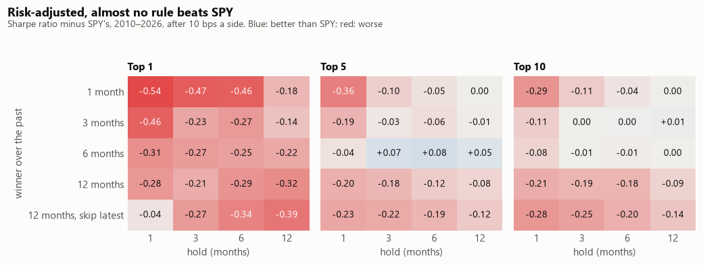
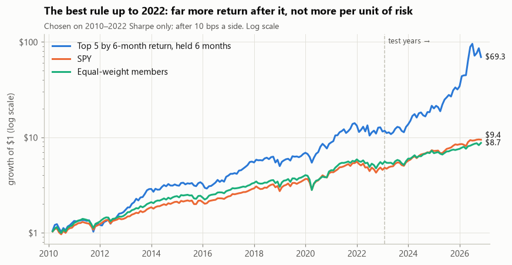
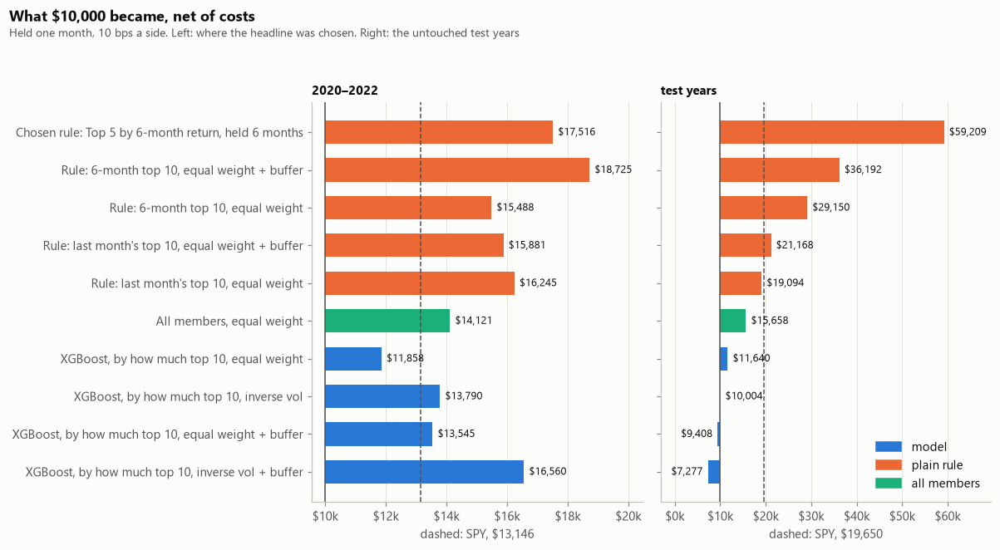

# Chapter 7: Trading simulation and results

> **Part 1** (sections 3.1–3.3): the baseline rule. **Part 2** (sections 3.4–3.7): the models from
> Chapter 6, traded. Equity curves over time and the market-trend filter are added in a later part.

## 1. Goal

Before asking a model to pick stocks, test the plain idea properly: at each month-end, buy the
members that rose the most, hold them, and compare with SPY. Three questions:

1. Does any version of "buy the winners" beat SPY after trading costs, and **on a risk-adjusted
   basis**, not just on raw return?
2. Which version works best: how far back to measure "winner", how many stocks to buy, and how long to
   hold them?
3. If the best version is chosen from many, is it real, or just the luckiest of the lot?

The answer is the **bar the models have to clear**. A model that can't beat the plain rule adds
nothing.

> **All numbers here are previews.** The download of delisted companies is still running, so the early
> years still miss most acquired companies. Everything gets rerun once it's complete.

---

## 2. What was done

| Choice | Values | Count |
| --- | --- | --- |
| "Winner" measured over the past | 1, 3, 6, 12 months, or 12 months skipping the latest | 5 |
| Stocks bought | top 1, 5 or 10, equal amounts | 3 |
| Hold | 1, 3, 6 or 12 months | 4 |

That's **60 rules**, all run over the whole period (February 2010 to October 2026) and **all reported**.
Reporting only the good ones would hide how many were tried.

How each rule is traded:

- **The trade happens at the next open** after the month-end, so a rule never trades at a price it
  couldn't have had.
- **Staggered portfolios.** With a 6-month hold, the money is split into six parts, and each month one
  part sells its stocks and buys that month's picks. The result then doesn't depend on which month
  the test happens to start in.
- **Costs of 0.1% on every buy and every sell.** A stock kept from one month's picks to the next is
  only traded by the difference, as a real portfolio would be.
- **Companies that leave the index stay held** until their part of the portfolio is due to sell. A
  company that's delisted is valued at its last price and then held as cash.
- **Two yardsticks:** SPY, and an equal-weight basket of every member, rebalanced monthly.
- **The Sharpe ratio subtracts the risk-free rate** (the Fed Funds rate) from the return before dividing
  by volatility.

The rule fits nothing to the data, so it needs no training period. But picking the best of 60 *is* a
kind of fitting. So the best rule is also **chosen on decisions made in 2010–2022 alone and then
followed through the decisions from January 2023**. Those are the same test years the models are
scored on, never used to choose anything, so the baseline and the models are compared on exactly the
same months.

**Every period is set by decision date.** A decision at the end of December 2022 earns January
2023's return, but it belongs to 2022, the years things were chosen on. So the test returns start in
February 2023.

---

## 3. What came out

### 3.1 More return, but more risk

| Yardstick, 2010–2026 | Yearly return | Volatility | Sharpe ratio | Worst fall |
| --- | --- | --- | --- | --- |
| SPY | 14.3% | 14.8% | 0.88 | −23% |
| Equal-weight members | 13.8% | 16.1% | 0.79 | −30% |

Of the 60 rules:

- **53 earn a higher yearly return than SPY.**
- **Only 7 have a better Sharpe ratio.**
- **All 60 have a deeper worst fall.**

Buying recent winners mostly buys more risk. In a market that rose for most of 2010–2026, more risk
was paid for with more return, but not with more return *per unit of risk*.

### 3.2 Which version works best

| Grid dimension | Best | Worst | Why |
| --- | --- | --- | --- |
| "Winner" over | **6 months** (best median return, Sharpe and worst fall) | Last month alone (lowest median return, deepest falls) | Last month's winners tend to fall back the month after (the short-term reversal seen in the feature analysis) |
| Stocks bought | 5 or 10 | **1** (a median worst fall of −54%) | A single stock's swings swamp everything else |
| Hold | 12 months | 1 month | Holding longer costs less: about 1.4% a year in trading costs with a 1-month hold, 0.2% with 12 months |

The best rule over the whole period buys the **top 5 by 6-month return and holds them 6 months**: 28.8%
a year, a Sharpe ratio of 0.97 against SPY's 0.88, and a worst fall of −27%. The best **top-10** rule
(3-month winners, held 12 months) has a Sharpe ratio of 0.90, close to a tie with SPY.

Even the best rule isn't clearly better than chance. Its average monthly return over SPY has a
t-statistic of 2.8, and 9 of the 60 rules clear 2. That's convincing for one rule chosen in advance,
but less so for the best of 60 related ones. None clears 3.

### 3.3 Chosen on 2010–2022, followed through the test years

The rule with the best Sharpe ratio on **decisions 2010–2022** turns out to be the same one: the top 5
by 6-month return, held 6 months.

| | Yearly return | Volatility | Sharpe ratio | Worst fall |
| --- | --- | --- | --- | --- |
| **Decisions 2010–2022** (chosen here) | | | | |
| The rule | 20.8% | 23.0% | 0.92 | −26% |
| SPY | 12.8% | 15.6% | 0.81 | −23% |
| **Decisions from Jan 2023** (test years, never used to choose) | | | | |
| The rule | 60.7% | 43.1% | 1.21 | −27% |
| SPY | 19.7% | 11.8% | 1.21 | −8% |
| Equal-weight members | 12.7% | 12.7% | 0.65 | −11% |

In the test years the rule **earned about three times SPY's yearly return**, and ranked 3rd of the 60
rules. But **per unit of risk it only matched SPY**: 43% volatility against 12%, and a worst fall of
−27% against −8%. The gain came from a handful of stocks riding the AI and memory-chip boom
(NVIDIA, Western Digital, Palantir, Seagate, GE Vernova, SanDisk, Micron), each picked at many
month-ends. That's a strong market theme the rule happened to catch, not a steady, broad edge.

### 3.4 Part 2: the models, traded

Each model's top picks are bought at the next open and **held one month**, because the models
predict next month. The trading rules are the same as Part 1's: 0.1% a side, delisted stocks held as
cash, and a stock kept from one month to the next only traded by the difference.

**Four versions of every strategy, fixed before any result was seen:**

| Version | How the money is split | When a stock is sold |
| --- | --- | --- |
| Equal weight (**main**) | Evenly | When it leaves the top N |
| Equal weight + buffer | Evenly | Only when it falls out of the top 2N |
| Inverse volatility | More to calmer stocks (∝ 1 / 3-month volatility) | When it leaves the top N |
| Inverse volatility + buffer | ∝ 1 / volatility | Only when it falls out of the top 2N |

The buffer exists because a top 10 changes a lot from month to month. The 6-month rule keeps about
half its picks, the headline model about a quarter, and last month's winners almost none. A stock that
slips from 9th to 12th hasn't really changed, so selling it pays fees for noise.

**Two periods:** 2020–2022, where the headline model was chosen, and the test years. 2014–2019 is
left out, because the models' scores for those years come from the folds their settings were chosen
on. Each period starts with **$10,000**.

### 3.5 The headline model loses to SPY and to the plain rules

| What $10,000 became | 2020–2022 (36 months) | Test years (45 months) | Sharpe, test years |
| --- | --- | --- | --- |
| SPY | $13,146 | $19,650 | 1.21 |
| All members, equal weight | $14,121 | $15,658 | 0.65 |
| Rule chosen in Part 1 (top 5, 6-month, held 6) | $17,516 | **$59,209** | 1.21 |
| Rule: 6-month top 10, held 1, with buffer | **$18,725** | $36,192 | 0.98 |
| Rule: 6-month top 10, held 1 | $15,488 | $29,150 | 0.84 |
| Rule: last month's top 10, held 1 | $16,245 | $19,094 | 0.57 |
| **Headline model, top 10** (main version) | $11,858 | $11,640 | 0.12 |
| Headline, inverse vol + buffer | $16,560 | $7,277 | −0.23 |

**The headline model did worse than SPY and than every plain rule in both periods.** Its best-looking
version on 2020–2022 (inverse volatility with the buffer, which beat SPY's Sharpe there) was its worst
on the test. That is why only the main version was fixed in advance. The best of four versions on
three years is partly luck.

### 3.6 What the buffer and the weighting did

- **The models trade a lot:** about 18 times the portfolio a year at top 10, against 11 for the
  6-month rule and 23 for last month's. For the headline that was about $600 in fees on $10,000 over
  2020–2022.
- **The buffer cut that trading by about 3 portfolio-turns a year,** averaged over the eight models.
  It changed their Sharpe ratio very little. For the 6-month rule at top 10 it helped in both
  periods: Sharpe 0.61 → 0.85 on 2020–2022, and 0.84 → 0.98 on the test. At top 1 and top 5 it
  didn't help consistently.
- **Inverse volatility didn't help consistently.** It raised the models' average Sharpe on 2020–2022
  (+0.05) and lowered it on the test (−0.11).

### 3.7 Chance winners, and the bottom line

Of 121 simulated strategies, **12 edge SPY's Sharpe in the test years**. Among so many related
tries, a few are expected to by chance. Most hold a single stock: the top 1 of the decision tree, the neural network or the
6-month rule. Of the strategies declared in advance, only the rule chosen in Part 1 does, and that's
a tie (1.21 against 1.21). The neural network was the best model on the test ($23,087 at top 10), after
a weak 2020–2022 ($10,748). Picking it now would be choosing on the test.

**On this data, the models add nothing that a plain 6-month momentum rule doesn't already do better,
and no strategy chosen in advance clearly beats SPY per unit of risk.**

---

## 4. Decisions and why

| Decision | Why |
| --- | --- |
| Every one of the 60 rules reported | Showing only the winners would hide how many were tried, and so how likely the best is to be luck |
| Staggered portfolios for holds longer than a month | One portfolio started in one month would make the result depend on that month |
| Costs on every buy and sell, netted for stocks kept | Monthly rules trade a lot. Without costs, the 1-month rules look about 1.4 points a year better than they are |
| Trade at the next open | Every rule only uses prices it could have had |
| Sharpe ratio net of the Fed Funds rate | Risky strategies should be compared on what they earn above cash |
| Best rule chosen on 2010–2022, then followed through 2023–2026 | A best-of-60 judged on the same years it was chosen on is flattered by the choice. These are the models' test years too, so every strategy is judged on the same untouched months |
| Top 10 kept as the headline for the models | Top 1 is far too volatile. Top 10 is close to SPY on a risk-adjusted basis, a fair bar for a model to beat |
| Every period set by decision date | A December 2022 decision belongs to the years things were chosen on. Counting its January return as "test" would score a strategy on a month it was chosen on. Fixed before the results; it happened to move SPY's test Sharpe from 1.29 to 1.21 |
| Models held one month | They were trained to predict next month. A longer hold would judge them on something they never learned |
| Four versions fixed in advance, one of them the main version | Each extra version is another chance to look good by luck. The others show whether the result depends on a detail |
| A buffer of twice the basket size | A stock that slips a few places hasn't changed. Selling it pays fees for noise |
| Inverse volatility as the only other weighting | It needs a risk forecast, not a return forecast, and volatility is fairly predictable. Weighting by the model's confidence would amplify a signal close to noise |
| Results shown in dollars from $10,000 | Easier to read than a yearly rate, and fees can be shown as an amount |
| 2014–2019 left out of the model results | The models' settings were chosen on those years, which flatters them |

---

## 5. Caveats

- **Previews only.** The early years still miss most acquired companies, and takeover targets are
  often among the recent winners. The numbers will change once the download finishes.
- **The test years are few.** Under four years, dominated by one market theme. One strong stretch
  can't settle whether the edge is lasting, and a single bad year for SPY would change the comparison.
  (With the cut a year earlier, SPY's poor 2022 makes the rule look better on Sharpe too. That's why
  the cut is fixed to the models' test window, not chosen by result.)
- **The model strategies have only 36 and 45 months each.** Differences of a few hundred dollars
  between versions can be chance. The conclusion rests on the headline losing in both periods to every
  plain rule shown, not on any one gap.
- **Rebalancing between the parts of a staggered portfolio isn't charged.** That trading is small next
  to the monthly picks, but it isn't zero.
- **The equal-weight yardstick has no costs,** so it's slightly flattered compared with the rules.
- **Taxes, short-term price impact and the bid-ask spread on small trades are not modelled.** The 0.1% per
  side is meant to cover the spread and commissions of a liquid large-cap stock.
