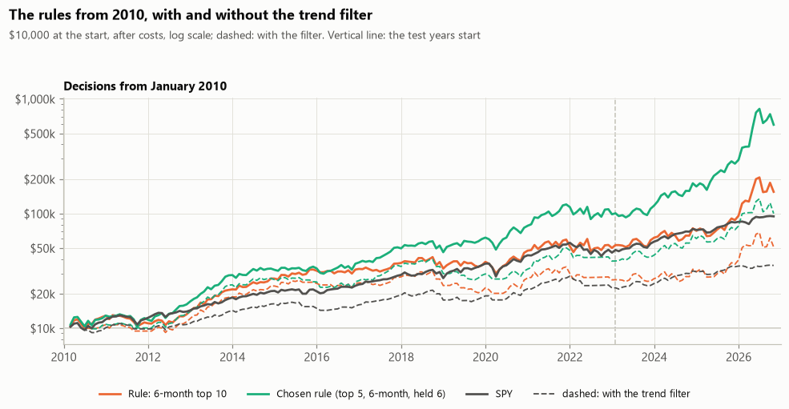
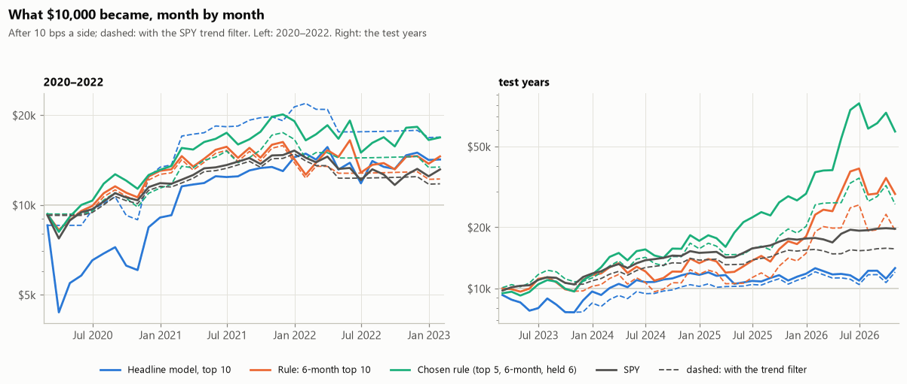
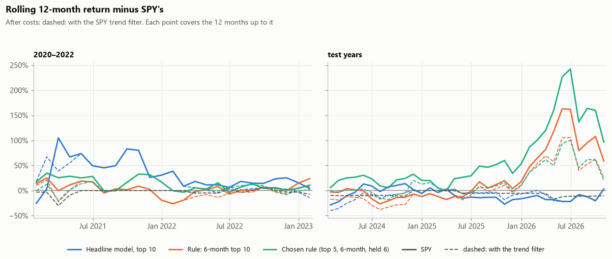

# Chapter 7: Trading simulation

> **Part 1** (3.1–3.3): the plain rule. **Part 2** (3.4–3.7): the Chapter 6 models, traded. **Part 3**
> (3.8–3.11): the paths, and a market-trend filter. **Part 4** (3.12–3.15): why the model loses.

## 1. Goal

Before asking a model to pick stocks, test the plain idea properly: at each month-end, buy the
members that rose the most, hold them, and compare with SPY. Three questions:

1. Does any version of "buy the winners" beat SPY after trading costs, and **on a risk-adjusted
   basis**, not just on raw return?
2. Which version works best: how far back to measure "winner", how many stocks to buy, and how long to
   hold them?
3. If the best version is chosen from many, is it real, or just the luckiest of the lot?

The answer is the **bar the models have to clear**. A model that can't beat the plain rule adds
nothing. The models are then traded the same way, a market-trend filter is tested on everything, and
the last part asks why the model loses.

---

## 2. What was done

| Choice | Values | Count |
| --- | --- | --- |
| "Winner" measured over the past | 1, 3, 6, 12 months, or 12 months skipping the latest | 5 |
| Stocks bought | top 1, 5 or 10, equal amounts | 3 |
| Hold | 1, 3, 6 or 12 months | 4 |

That's **60 rules**, all run over the whole period (February 2010 to October 2026) and **all reported**.
Reporting only the good ones would hide how many were tried.

How each rule is traded:

- **The trade happens at the next open** after the month-end, so a rule never trades at a price it
  couldn't have had.
- **Staggered portfolios.** With a 6-month hold, the money is split into six parts, and each month one
  part sells its stocks and buys that month's picks. The result then doesn't depend on which month
  the test happens to start in.
- **Costs of 0.1% on every buy and every sell.** A stock kept from one month's picks to the next is
  only traded by the difference, as a real portfolio would be.
- **Companies that leave the index stay held** until their part of the portfolio is due to sell. A
  company that's delisted is valued at its last price and then held as cash.
- **Two yardsticks:** SPY, and an equal-weight basket of every member, rebalanced monthly.
- **The Sharpe ratio subtracts the risk-free rate** (the Fed Funds rate) from the return before dividing
  by volatility.

The rule fits nothing to the data, so it needs no training period. But picking the best of 60 *is* a
kind of fitting. So the best rule is also **chosen on decisions made in 2010–2022 alone and then
followed through the decisions from January 2023**. Those are the same test years the models are
scored on, never used to choose anything, so the baseline and the models are compared on exactly the
same months.

**Every period is set by decision date.** A decision at the end of December 2022 earns January
2023's return, but it belongs to 2022, the years things were chosen on. So the test returns start in
February 2023.

---

## 3. What came out

### 3.1 More return, but more risk

| Yardstick, 2010–2026 | Yearly return | Volatility | Sharpe ratio | Worst fall |
| --- | --- | --- | --- | --- |
| SPY | 14.3% | 14.8% | 0.88 | −23% |
| Equal-weight members | 13.5% | 16.1% | 0.78 | −30% |

Of the 60 rules:

- **52 earn a higher yearly return than SPY.**
- **Only 3 have a better Sharpe ratio.**
- **All 60 have a deeper worst fall.**

Buying recent winners mostly buys more risk. In a market that rose for most of 2010–2026, more risk
was paid for with more return, but not with more return *per unit of risk*.

### 3.2 Which version works best

| Grid dimension | Best | Worst | Why |
| --- | --- | --- | --- |
| "Winner" over | **6 months** (best median return, Sharpe and worst fall) | Last month alone (lowest median return, deepest falls) | Last month's winners tend to fall back the month after (the short-term reversal seen in the feature analysis) |
| Stocks bought | 5 or 10 | **1** (a median worst fall of −56%) | A single stock's swings swamp everything else |
| Hold | 12 months | 1 month | Holding longer costs less: about 1.4% a year in trading costs with a 1-month hold, 0.2% with 12 months |

The best rule over the whole period buys the **top 5 by 6-month return and holds them 6 months**: 27.6%
a year, a Sharpe ratio of 0.94 against SPY's 0.88, and a worst fall of −27%. The best **top-10** rule
(3-month winners, held 12 months) has a Sharpe ratio of 0.875, just below SPY's.

Even the best rule isn't clearly better than chance. Its average monthly return over SPY has a
t-statistic of 2.6, and 4 of the 60 rules clear 2. That's convincing for one rule chosen in advance,
but less so for the best of 60 related ones. None clears 3.

### 3.3 Chosen on 2010–2022, followed through the test years

The rule with the best Sharpe ratio on **decisions 2010–2022** turns out to be the same one: the top 5
by 6-month return, held 6 months.

| | Yearly return | Volatility | Sharpe ratio | Worst fall |
| --- | --- | --- | --- | --- |
| **Decisions 2010–2022** (chosen here) | | | | |
| The rule | 19.4% | 22.8% | 0.87 | −26% |
| SPY | 12.8% | 15.6% | 0.81 | −23% |
| **Decisions from Jan 2023** (test years, never used to choose) | | | | |
| The rule | 60.7% | 43.1% | 1.21 | −27% |
| SPY | 19.7% | 11.8% | 1.21 | −8% |
| Equal-weight members | 12.6% | 12.8% | 0.64 | −11% |

In the test years the rule **earned about three times SPY's yearly return**, and ranked 3rd of the 60
rules. But **per unit of risk it only matched SPY**: 43% volatility against 12%, and a worst fall of
−27% against −8%. The gain came from a handful of stocks riding the AI and memory-chip boom
(NVIDIA, Western Digital, Palantir, Seagate, GE Vernova, SanDisk, Micron), each picked at many
month-ends. That's a strong market theme the rule happened to catch, not a steady, broad edge.

### 3.4 Part 2: the models, traded

Each model's top picks are bought at the next open and **held one month**, because the models
predict next month. The trading rules are the same as Part 1's: 0.1% a side, delisted stocks held as
cash, and a stock kept from one month to the next only traded by the difference.

**Four versions of every strategy, fixed before any result was seen:**

| Version | How the money is split | When a stock is sold |
| --- | --- | --- |
| Equal weight (**main**) | Evenly | When it leaves the top N |
| Equal weight + buffer | Evenly | Only when it falls out of the top 2N |
| Inverse volatility | More to calmer stocks (∝ 1 / 3-month volatility) | When it leaves the top N |
| Inverse volatility + buffer | ∝ 1 / volatility | Only when it falls out of the top 2N |

The buffer exists because a top 10 changes a lot from month to month. The 6-month rule keeps about
half its picks, the headline model about a fifth, and last month's winners almost none. A stock that
slips from 9th to 12th hasn't really changed, so selling it pays fees for noise.

**Two periods:** 2020–2022, where the headline model was chosen, and the test years. 2014–2019 is
left out, because the models' scores for those years come from the folds their settings were chosen
on. Each period starts with **$10,000**.

**What each period is clean for.** The plain 1-month rules chose nothing, so both periods are fair
for them. The headline model and the Part 1 rule were chosen on years that include 2020–2022, so for
them only the test years are a fair judgement.

### 3.5 The headline model loses to the plain rules, and on the test to SPY

| What $10,000 became | 2020–2022 (36 months) | Test years (45 months) | Sharpe, test years |
| --- | --- | --- | --- |
| SPY | $13,146 | $19,650 | 1.21 |
| All members, equal weight | $14,054 | $15,599 | 0.64 |
| Rule chosen in Part 1 (top 5, 6-month, held 6) | $16,824 | **$59,209** | 1.21 |
| Rule: 6-month top 10, held 1, with buffer | $16,759 | $36,192 | 0.98 |
| Rule: 6-month top 10, held 1 | $14,538 | $29,150 | 0.84 |
| Rule: last month's top 10, held 1 | $15,400 | $18,987 | 0.56 |
| **Headline model, top 10** (main version) | $14,193 | $12,583 | 0.18 |
| Headline, equal weight + buffer | **$17,143** | $11,794 | 0.10 |

**The headline model lost to every plain rule in both periods, and to SPY on the test years.** On
2020–2022 it did beat SPY. Its best-looking version there (equal weight with the buffer, the best of
every strategy shown) was its worst on the test: the best of four versions on three years is partly
luck, which is why only the main version was fixed in advance.

### 3.6 What the buffer and the weighting did

- **The models trade a lot:** about 19 times the portfolio a year at top 10, against 11 for the
  6-month rule and 23 for last month's. For the headline that was about $680 in fees on $10,000 over
  2020–2022.
- **The buffer cut that trading by about 3 portfolio-turns a year,** averaged over the eight models.
  It changed their Sharpe ratio very little. For the 6-month rule at top 10 it helped in both
  periods: Sharpe 0.54 → 0.72 on 2020–2022, and 0.84 → 0.98 on the test. At top 1 and top 5 it
  didn't help consistently.
- **Inverse volatility didn't help consistently.** It barely changed the models' average Sharpe on
  2020–2022 (+0.01) and lowered it on the test (−0.14).

### 3.7 Chance winners, and the bottom line

Of 121 simulated strategies, only **3 edge SPY's Sharpe in the test years**: the 6-month rule's single
best stock (two of its versions are identical with one stock) and the Part 1 rule, which ties (1.21
against 1.21). No model strategy does. The random forest was the best model on the test ($19,144 at
top 10) after a weak 2020–2022 ($10,429); picking it now would be choosing on the test.

**A second, much simpler method agrees.** The same picks were run through a plain calculation: $100
into every pick at the next open, every buy and sell charged (kept stocks too), nothing reinvested.
On the test years it ranks the strategies the same way: the headline model 7.1% a year, the 6-month
rule 24.5%, the chosen rule 42.1%, against 6.3%, 33.0% and 60.7% in the full simulation. The levels
differ because only the full simulation compounds, which lifts the strong rules most. For the
headline the simple figure is a little higher, since without compounding its swings don't drag on
the months after them.

**On this data, the models add nothing that a plain 6-month momentum rule doesn't already do better,
and no strategy chosen in advance clearly beats SPY per unit of risk.**

### 3.8 Part 3: the paths, and a market-trend filter

The end values above hide the path. This part follows each strategy month by month, and tests one
classic defence against the worst stretches.

**The trend filter.** When SPY closes a month below the average of its last ten month-end closes
(about its 200-day average), sell everything at the next open and hold cash at the Fed Funds rate
until it's back above. Ten months is a published convention, not tuned here. It aims at momentum's
worst losses, which come in long declines; its known weakness is a fast fall and recovery.

Every Part 2 strategy, and SPY, was run with and without it. As declared in advance, the filter is a
reported test, not a candidate: only its average effect and the pre-declared strategies are shown,
no filtered version was picked from the list, and every headline result stays unfiltered.

### 3.9 The filter helped in one long decline, and hurt everywhere else

| What $10,000 became | 2020–2022 | with the filter | Test years | with the filter |
| --- | --- | --- | --- | --- |
| SPY | $13,146 | $11,764 | $19,650 | $15,660 |
| Rule chosen in Part 1 | $16,824 | $13,390 | $59,209 | $25,945 |
| Rule: 6-month top 10, held 1 | $14,538 | $12,211 | $29,150 | $19,302 |
| Headline model, top 10 | $14,193 | **$16,862** | $12,583 | $12,033 |

- **On 2020–2022 it helped most strategies.** That stretch includes 2022's long decline, the setting a
  trend filter is built for. It raised the Sharpe ratio of about 70% of all strategies, made their
  worst falls 17–19 points shallower on average, and cut the headline model's worst fall from −56% to
  −23%. It still lowered the Sharpe ratio of SPY and of both plain rules shown.
- **Everywhere else it hurt.** On the test years it raised the Sharpe ratio of only 3–7% of the
  strategies. Over 2010–2026, filtered SPY earned 7.8% a year against 14.3%, with a Sharpe ratio of
  0.58 against 0.88.
- **The cause: it kept missing the rebound.** It was out of the market at 31 of the 201 month-ends
  since 2010. In exactly the months that followed, SPY rose 3.5% on average, against 0.8% in the
  months it was in. The months it sat out included April 2020 (+15%), January 2019 (+10%) and July
  2022 (+9%).
- **In the test years it rarely triggered,** at 4 of 45 month-ends, each after SPY had already fallen.
  The worst falls barely changed.
- **Since 2010 it even deepened the rules' worst falls** (the 6-month rule: −28% → −36%), because it
  sold low and bought back higher. Most downturns since 2010 recovered quickly, the setting where
  trend filters do worst.

### 3.10 What the paths show

- **The rules' test-year lead arrived in one burst.** The 6-month rule ran roughly level with SPY until
  mid-2025. The chosen rule was ahead from 2024, but most of both leads came in late 2025 and 2026,
  during the AI and memory-chip rally (section 3.3): a bet that paid off, not a steady edge.
- **The headline model has the most violent path:** on 2020–2022 it fell as far as −56% from its
  previous peak, against SPY's −23%.

### 3.11 The bottom line of the simulations

The filter stays what it was declared to be: a reported test. Its verdict is mixed (a real help in a
long decline, a cost in fast recoveries and over the whole period), and no result here depends on it.
Part 2's conclusion stands: **no strategy chosen in advance clearly beats SPY per unit of risk.**

### 3.12 Part 4: why the model loses

Part 4 compares the headline model with the 6-month rule (both top 10, held one month). **It is
descriptive only:** cutting results many ways always finds a slice that looks good by chance, so
nothing here becomes a strategy. Margins of error come from the spread across months, because ten
picks made in the same month move together.

**What each strategy actually buys** (average percentile among that month's members; 50 = average):

| | Volatility | Beta | Size | 6-month return | Last month's return |
| --- | --- | --- | --- | --- | --- |
| Headline model, 2020–2022 | 73 | 63 | 51 | **29** | **27** |
| Headline model, test years | 46 | 40 | 50 | 44 | 41 |
| 6-month rule, 2020–2022 | 79 | 70 | 71 | 99 | 74 |
| 6-month rule, test years | 85 | 75 | 79 | 99 | 75 |

**The headline model isn't a momentum strategy, and its bet changed between the periods.** On
2020–2022 it bought volatile, beaten-down stocks: in effect, a bet on rebounds. On the test years it
bought calmer stocks, with below-average beta and middling past returns: a defensive tilt. The
6-month rule bought the period's winners both times, which are volatile and larger than average.

### 3.13 The model's bets followed the market

- **The model's two bets show in up and down months.** On 2020–2022 its picks beat SPY 43% of the
  time in months when SPY fell, against 53% for all members, and 58% against 48% when it rose: the
  rebound bet. On the test years it was the reverse: 56% against 51% in down months, 41% against 43%
  in up months, the defensive tilt in a mostly rising market. None of these slices is clearly beyond
  noise (at most 1.6 standard errors).
- **The 6-month rule is a market bet too, and a winning one in the test years.** In SPY's up months
  its picks beat the base rate by 13.5 points (3.4 standard errors); in down months they trailed by
  6.4. Its edge in hit rate shows up in 6 of the 7 years; the model's in 4.
- **The rule's test years are a technology bet.** 46% of its picks were technology stocks, against 14%
  of members. The model leaned towards energy on 2020–2022 (21% of its picks against 5% of members)
  and towards utilities on the test years (15% against 6%). None of its sector slices is convincing,
  given how many were cut.

### 3.14 Each strategy's typical mistake

- **The model buys falling knives.** Its worst picks came at the end of February 2020, when it bought
  Macy's and beaten-down energy stocks just before the Covid crash. 10% of its picks left the index
  within a year, against 3% of all members and 1% of the rule's.
- **The rule buys at the top of a run.** Its worst picks came in 2026, after enormous run-ups (one
  stock had risen over 800% in six months). Several then did 30% or more worse than SPY in a single
  month.

### 3.15 Ideas for future work

None of these was built or tested. There's no untouched data left here to test them on honestly,
so each would need new months or a separate earlier period.

1. **Take the market's direction out of the model.** Rank on returns after removing each stock's
   market exposure, or choose within volatility bands, to see whether any stock-picking skill
   remains once the bet on SPY rising is gone.
2. **Give the model a risk-adjusted target** (excess return divided by volatility, or the rank within
   the month), so the largest swings stop dominating its top picks.
3. **Use the model to filter the rule rather than replace it:** drop the rule's candidates the model
   scores worst, to test whether it has learned what precedes a collapse.
4. **Cap the rule's sector weights,** so its result depends less on one theme.

---

## 4. Decisions and why

| Decision | Why |
| --- | --- |
| Sharpe ratio net of the Fed Funds rate | Risky strategies should be compared on what they earn above cash |
| Top 10 kept as the headline for the models | Top 1 is far too volatile. Top 10 is close to SPY on a risk-adjusted basis, a fair bar for a model to beat |
| Every period set by decision date (§2) | Fixed before any result was seen; it happened to lower SPY's test Sharpe from 1.29 to 1.21 |
| Inverse volatility as the only other weighting | Volatility is fairly predictable; weighting by the model's confidence would amplify a signal close to noise |
| Results shown in dollars from $10,000 | Easier to read than a yearly rate, and fees can be shown as an amount |
| The filter's "out" sells the whole portfolio | Only stopping new buys would take six months to leave a six-month hold |
| Strategies compared only on months they share | A line starting ten years earlier would look better from compounding alone |
| Calendar months not broken down | Six or seven observations per month: almost pure noise |

---

## 5. Caveats

- **Some early takeovers have no free price at all ([Chapter 3](03_monthly_table.md)),** and
  takeover targets are often among the recent winners, so the rules' results may still be slightly
  flattered.
- **The test years are few:** under four, dominated by one market theme. A single bad year for SPY
  would change the comparison; with the cut a year earlier, SPY's poor 2022 makes the rule win on
  Sharpe too, which is why the cut was fixed in advance.
- **The model strategies have only 36 and 45 months.** Gaps of a few hundred dollars between versions
  can be chance; the conclusion rests on the headline losing to every plain rule in both periods.
- **The trend filter met few downturns,** and most recovered fast. Published tests credit such filters
  mainly with long bear markets like 2000–2002 and 2008, outside these years: it didn't help *here*.
- **Some costs aren't modelled:** rebalancing between the parts of a staggered portfolio (small, not
  zero), costs for the equal-weight yardstick (slightly flattering it), taxes, price impact, and wider
  spreads on small trades. The 0.1% a side covers the spread and commissions of a liquid large-cap.
