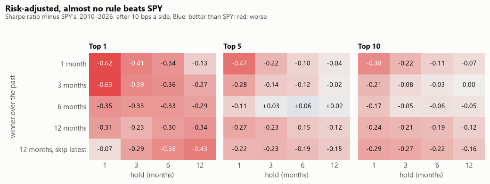
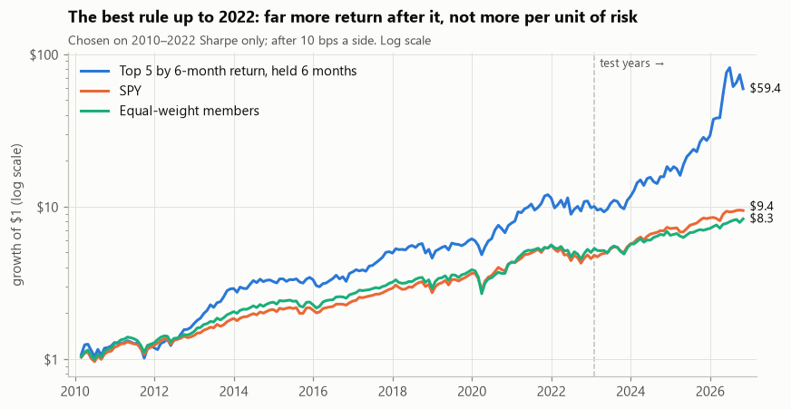
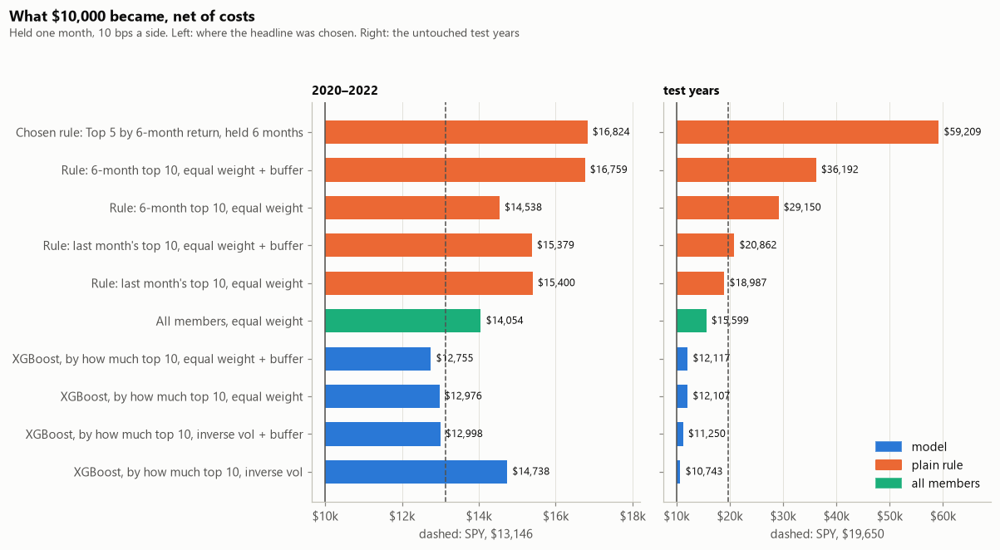
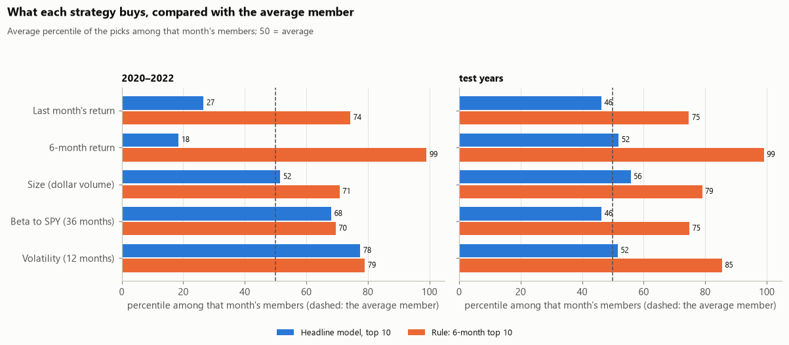
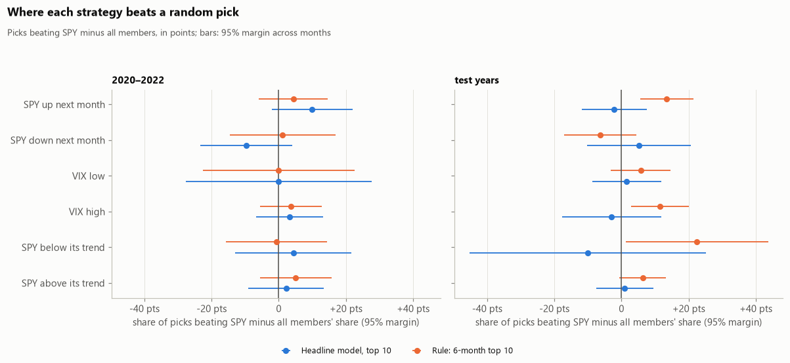

# Chapter 7: Trading simulation

> **Part 1** (3.1–3.3): the plain rule. **Part 2** (3.4–3.7): the Chapter 6 models, traded.
> **Part 3** (3.8–3.10): the paths, and a market-trend filter. **Part 4** (3.11–3.14): why the
> model loses.

## 1. Goal

Before asking a model to pick stocks, test the plain idea properly: at each month-end, buy the
members that rose the most, hold them, and compare with SPY. Three questions:

1. Does any version of "buy the winners" beat SPY after trading costs, and **on a risk-adjusted
   basis**, not just on raw return?
2. Which version works best: how far back to measure "winner", how many stocks to buy, and how
   long to hold them?
3. If the best version is chosen from many, is it real, or just the luckiest of the lot?

The answer is the **bar the models have to clear**: a model that can't beat the plain rule adds
nothing. The later parts then trade the models the same way, test a market-trend filter on
everything, and ask why the model loses.

---

## 2. What was done

| Choice | Values | Count |
| --- | --- | --- |
| "Winner" measured over the past | 1, 3, 6, 12 months, or 12 months skipping the latest | 5 |
| Stocks bought | top 1, 5 or 10, equal amounts | 3 |
| Hold | 1, 3, 6 or 12 months | 4 |

That's **60 rules**, all run over the whole period (February 2010 to October 2026) and **all
reported**: showing only the good ones would hide how many were tried.

How each rule is traded:

- **At the next open** after the month-end, so a rule never trades at a price it couldn't have had.
- **Staggered portfolios.** With a 6-month hold, the money is split into six parts. Each month, one
  part sells its stocks and buys that month's picks, so the result doesn't depend on the month the
  test starts in.
- **Costs of 0.1% on every buy and every sell.** A stock kept from one month's picks to the next is
  traded only by the difference, as in a real portfolio.
- **Companies that leave the index stay held** until their part of the portfolio is due to sell. A
  delisted company is valued at its last price, then held as cash.
- **Two yardsticks:** SPY, and an equal-weight basket of every member, rebalanced monthly.
- **The Sharpe ratio** is the return minus the risk-free rate (the Fed Funds rate), divided by
  volatility.

The rule fits nothing to the data, so it needs no training period. But picking the best of 60 *is* a
kind of fitting. So the best rule is also **chosen on decisions made in 2010–2022 alone, then
followed through the decisions from January 2023**: the test years the models are scored on, never
used to choose anything. The baseline and the models are compared on exactly the same months.

**Every period is set by decision date.** A decision at the end of December 2022 earns January
2023's return but belongs to 2022, the years things were chosen on, so the test returns start in
February 2023. This was fixed before any result was seen. It happened to lower SPY's test Sharpe
ratio from 1.29 to 1.21, because January 2023 was a strong month for SPY.

---

## 3. What came out

### 3.1 More return, but more risk

| Yardstick, 2010–2026 | Yearly return | Volatility | Sharpe ratio | Worst fall |
| --- | --- | --- | --- | --- |
| SPY | 14.3% | 14.8% | 0.88 | −23% |
| Equal-weight members | 13.5% | 16.1% | 0.77 | −30% |

Of the 60 rules:

- **52 earn a higher yearly return than SPY.**
- **Only 3 have a better Sharpe ratio.**
- **All 60 have a deeper worst fall.**

Buying recent winners mostly buys more risk. In a market that rose for most of 2010–2026, the extra
risk paid off in return, but not in return *per unit of risk*.

### 3.2 Which version works best

| Grid dimension | Best | Worst | Why |
| --- | --- | --- | --- |
| "Winner" over | **6 months** (best median return, Sharpe and worst fall) | Last month alone (lowest median return, deepest falls) | Last month's winners tend to fall back the next month (the short-term reversal in the feature analysis) |
| Stocks bought | 5 or 10 | **1** (a median worst fall of −54%) | A single stock's swings swamp everything else |
| Hold | 12 months | 1 month | Holding longer costs less: trading costs of about 1.4% a year with a 1-month hold, 0.2% with 12 months |

The best rule over the whole period buys the **top 5 by 6-month return and holds them 6 months**:
27.6% a year, a Sharpe ratio of 0.94 against SPY's 0.88, and a worst fall of −27%. The best
**top-10** rule (3-month winners, held 12 months) has a Sharpe ratio of 0.878, just below SPY's
0.880.

**Even the best rule isn't clearly better than chance.** Its average monthly return over SPY has a
t-statistic of 2.6: convincing for one rule chosen in advance, less so for the best of 60 related
ones. Of the 60 rules, 4 clear 2; none clears 3.

### 3.3 Chosen on 2010–2022, followed through the test years

The rule with the best Sharpe ratio on **decisions 2010–2022** turns out to be the same one: the
top 5 by 6-month return, held 6 months.

| | Yearly return | Volatility | Sharpe ratio | Worst fall |
| --- | --- | --- | --- | --- |
| **Decisions 2010–2022** (chosen here) | | | | |
| The rule | 19.4% | 22.8% | 0.87 | −26% |
| SPY | 12.8% | 15.6% | 0.81 | −23% |
| **Decisions from Jan 2023** (test years, never used to choose) | | | | |
| The rule | 60.7% | 43.1% | 1.21 | −27% |
| SPY | 19.7% | 11.8% | 1.21 | −8% |
| Equal-weight members | 12.6% | 12.8% | 0.64 | −11% |

In the test years the rule **earned about three times SPY's yearly return** and ranked 3rd of the
60 rules. But **per unit of risk it only matched SPY**: 43% volatility against 12%, and a worst fall
of −27% against −8%. The gain came from a handful of stocks riding the AI and memory-chip boom
(NVIDIA, Western Digital, Palantir, Seagate, GE Vernova, SanDisk, Micron), each picked at many
month-ends: a strong market theme the rule happened to catch, not a steady, broad edge.

### 3.4 Part 2: the models, traded

Each model's top picks are bought at the next open and **held one month**, because the models
predict next month. Otherwise the trading is as in Part 1.

**Four versions of every strategy, fixed before any result was seen:**

| Version | How the money is split | When a stock is sold |
| --- | --- | --- |
| Equal weight (**main**) | Evenly | When it leaves the top N |
| Equal weight + buffer | Evenly | Only when it falls out of the top 2N |
| Inverse volatility | More to calmer stocks (in proportion to 1 / 3-month volatility) | When it leaves the top N |
| Inverse volatility + buffer | The same | Only when it falls out of the top 2N |

**Why a buffer:** a top 10 changes a lot from month to month. The 6-month rule keeps about half its
picks, the headline model about a fifth, last month's winners almost none. A stock that slips from
9th to 12th hasn't really changed, so selling it pays fees for noise.

**Two periods, each starting with $10,000:** 2020–2022, where the headline model was chosen, and the
test years. (2014–2019 is left out: the models' scores for those years come from the folds their
settings were chosen on.) The plain 1-month rules chose nothing, so both periods are fair for them.
The headline model and the Part 1 rule were chosen on years that include 2020–2022, so only the
test years judge them fairly.

### 3.5 The headline model loses to the plain rules and to SPY

| What $10,000 became | 2020–2022 (36 months) | Test years (45 months) | Sharpe, test years |
| --- | --- | --- | --- |
| SPY | $13,146 | $19,650 | 1.21 |
| All members, equal weight | $14,054 | $15,599 | 0.64 |
| Rule chosen in Part 1 (top 5, 6-month, held 6) | $16,824 | **$59,209** | 1.21 |
| Rule: 6-month top 10, held 1, with buffer | $16,759 | $36,192 | 0.98 |
| Rule: 6-month top 10, held 1 | $14,538 | $29,150 | 0.84 |
| Rule: last month's top 10, held 1 | $15,400 | $18,987 | 0.56 |
| **Headline model, top 10** (main version) | $12,976 | $12,107 | 0.12 |
| Headline, inverse volatility | $14,738 | $10,743 | −0.04 |

**The headline model lost to every plain rule and to SPY in both periods.** Its best-looking
version on 2020–2022, inverse volatility (the only one ahead of SPY), was its worst on the test.
The best of four versions on three years is partly luck, which is why only the main version was
fixed in advance as the headline.

Chapter 6 found its picks beat SPY by about 1% a month on average over 2020–2022. Traded, that
disappears: fees take about 1.8% a year, and a portfolio this volatile (52% a year, against SPY's
22%) compounds to much less than its average month suggests.

### 3.6 What the buffer and the weighting did

- **The models trade a lot:** about 18 times the portfolio a year at top 10, against 11 for the
  6-month rule and 23 for last month's. For the headline, that was about $570 in fees on $10,000
  over 2020–2022.
- **The buffer cut that trading by about three times the portfolio a year** (averaged over the
  eight models), with very little change to their Sharpe ratio. For the 6-month rule at top 10 it
  helped in both periods: Sharpe 0.54 → 0.72 on 2020–2022, and 0.84 → 0.98 on the test. At top 1
  and top 5 it didn't help consistently.
- **Inverse volatility didn't help consistently:** it barely changed the models' average Sharpe on
  2020–2022 (+0.01) and lowered it on the test (−0.15).

### 3.7 Chance winners, and the bottom line

Of 121 simulated strategies, only **3 edge SPY's Sharpe in the test years**: the 6-month rule's
single best stock (two of its versions are identical with one stock), and the Part 1 rule, which
ties. No model strategy does.

The neural network was the best model on the test ($25,339 at top 10: more than SPY, but with a
lower Sharpe ratio, 0.97), after a weak 2020–2022 ($8,878, second-worst of the eight). Picking it
now would be choosing on the test.

A much simpler method ($100 into every pick, nothing reinvested) ranks the strategies the same way
on the test years. The levels differ because only the full simulation compounds.

**On this data, the model chosen in advance adds nothing that a plain 6-month momentum rule doesn't
already do better, and no strategy chosen in advance clearly beats SPY per unit of risk.** Two
models not chosen did better per unit of risk than the 6-month rule on the test, but nothing seen
before it pointed to them.

### 3.8 Part 3: the paths, and a market-trend filter

The end values above hide the path. This part follows each strategy month by month and tests one
classic defence against the worst stretches.

**The trend filter.** When SPY closes a month below the average of its last ten month-end closes
(about its 200-day average), sell everything at the next open and hold cash at the Fed Funds rate
until it's back above.

- **Ten months is a published convention,** not tuned here.
- **It aims at momentum's worst losses,** which come in long declines. Its known weakness is a fast
  fall and recovery.
- **Every Part 2 strategy, and SPY, was run with and without it.**
- **As declared in advance, it's a reported test, not a candidate:** only its average effect and the
  pre-declared strategies are shown, no filtered version was picked from the list, and every
  headline result stays unfiltered.

### 3.9 The filter helped in one long decline, and hurt everywhere else

| What $10,000 became | 2020–2022 | with the filter | Test years | with the filter |
| --- | --- | --- | --- | --- |
| SPY | $13,146 | $11,764 | $19,650 | $15,660 |
| Rule chosen in Part 1 | $16,824 | $13,390 | $59,209 | $25,945 |
| Rule: 6-month top 10, held 1 | $14,538 | $12,211 | $29,150 | $19,302 |
| Headline model, top 10 | $12,976 | **$14,714** | $12,107 | $10,613 |

- **On 2020–2022 it helped most strategies.** That stretch includes 2022's long decline, the
  setting a trend filter is built for. It raised the Sharpe ratio of about 60% of all strategies,
  made their worst falls 16–18 points shallower on average, and cut the headline model's worst fall
  from −56% to −24%. It still lowered the Sharpe ratio of SPY and of both plain rules shown.
- **Everywhere else it hurt.** On the test years it raised no strategy's Sharpe ratio. Over
  2010–2026, filtered SPY earned 7.8% a year against 14.3%, with a Sharpe ratio of 0.58 against
  0.88.
- **The cause: it kept missing the rebound.** It was out of the market at 31 of the 201 month-ends
  since 2010. In exactly the months that followed, SPY rose 3.5% on average, against 0.8% in the
  months it was in. The months it sat out included April 2020 (+15%), January 2019 (+10%) and July
  2022 (+9%).
- **In the test years it rarely triggered:** at 4 of 45 month-ends, each after SPY had already
  fallen. The worst falls barely changed.
- **Since 2010 it even deepened the rules' worst falls** (the 6-month rule: −28% → −36%), because it
  sold low and bought back higher. Most downturns since 2010 recovered quickly, the setting where
  trend filters do worst.

The verdict is mixed: a real help in a long decline, a cost in fast recoveries and over the whole
period. No result here depends on it.

### 3.10 What the paths show

- **The rules' test-year lead arrived in one burst.** The 6-month rule ran roughly level with SPY
  until late 2025. The chosen rule was ahead from 2024, but most of both leads came in late 2025 and
  2026, in the AI and memory-chip rally (section 3.3): a bet that paid off, not a steady edge.
- **The headline model has the most violent path:** on 2020–2022 it fell as far as −56% from its
  previous peak, against SPY's −23%.

### 3.11 Part 4: why the model loses

Part 4 compares the headline model with the 6-month rule (both top 10, held one month).

- **It is descriptive only.** Cutting results many ways always finds a slice that looks good by
  chance, so nothing here becomes a strategy.
- **Margins of error come from the spread across months,** because ten picks made in the same month
  move together.

**What each strategy actually buys** (average percentile among that month's members; 50 = average):

| | Volatility | Beta | Size | 6-month return | Last month's return |
| --- | --- | --- | --- | --- | --- |
| Headline model, 2020–2022 | 78 | 68 | 52 | **18** | **27** |
| Headline model, test years | 52 | 46 | 56 | 52 | 46 |
| 6-month rule, 2020–2022 | 79 | 70 | 71 | 99 | 74 |
| 6-month rule, test years | 85 | 75 | 79 | 99 | 75 |

**The headline model isn't a momentum strategy, and its bet changed between the periods.** On
2020–2022 it bought volatile, beaten-down stocks: in effect, a bet on rebounds. On the test years
its picks looked like an average member on every measure (percentiles 46–56): no clear bet at all.
The 6-month rule bought the period's winners both times: volatile, and larger than average.

### 3.12 The model's bets followed the market

The *base rate* is the share of all members that beat SPY that month (what a random pick scores);
a gap of about two *standard errors* is the usual bar for "more than noise".

**The model's bets show in up and down months.** How often its picks beat SPY (all members' rate in
brackets):

| | Months SPY fell | Months SPY rose |
| --- | --- | --- |
| 2020–2022 | 42% (53%) | 58% (48%) |
| Test years | 54% (51%) | 39% (43%) |

On 2020–2022 that's the rebound bet. On the test years the lean was mild and the other way. None
of these slices is clearly beyond noise (at most 1.8 standard errors).

- **The 6-month rule is a market bet too, and a winning one in the test years.** In SPY's up months
  its picks beat the base rate by 13.5 points (3.4 standard errors); in down months they trailed by
  6.4. Its edge in hit rate shows up in 6 of the 7 years; the model's in 3 (2020, 2022 and 2024).
- **The rule's test years are a technology bet:** 46% of its picks were technology stocks, against
  14% of members. The model leaned towards energy on 2020–2022 (16% of its picks against 5% of
  members) and mildly towards technology on the test years (20% against 14%). None of its sector
  slices is convincing, given how many were cut.

### 3.13 Each strategy's typical mistake

- **The model buys falling knives.** Its worst picks came at the end of February 2020, when it
  bought beaten-down energy stocks (Occidental, Halliburton, Diamondback Energy, TechnipFMC,
  Cimarex) and DXC just before the Covid crash. 10% of its picks left the index within a year,
  against 3% of all members and 1% of the rule's.
- **The rule buys at the top of a run.** Its worst test-year picks came mostly in 2026, after
  enormous run-ups (one stock had risen over 800% in six months). Several then did 30% or more worse
  than SPY in a single month.

### 3.14 Ideas for future work

None of these was built or tested. No untouched data is left here to test them on honestly, so each
would need new months or a separate earlier period.

1. **Take the market's direction out of the model.** Rank on returns after removing each stock's
   market exposure, or choose within volatility bands, to see whether any stock-picking skill
   remains once the bet on SPY rising is gone.
2. **Give the model a risk-adjusted target** (excess return divided by volatility, or the rank
   within the month), so the largest swings stop dominating its top picks.
3. **Use the model to filter the rule rather than replace it:** drop the rule's candidates the model
   scores worst, to test whether it has learned what precedes a collapse.
4. **Cap the rule's sector weights,** so its result depends less on one theme.

---

## 4. Decisions and why

| Decision | Why |
| --- | --- |
| Sharpe ratio net of the Fed Funds rate | Risky strategies should be compared on what they earn above cash |
| Top 10 kept as the headline for the models | Top 1 is far too volatile. Top 10 is close to SPY on a risk-adjusted basis, a fair bar for a model to beat |
| Inverse volatility as the only other weighting | Volatility is fairly predictable; weighting by the model's confidence would amplify a signal close to noise |
| Results shown in dollars from $10,000 | Easier to read than a yearly rate, and fees can be shown as an amount |
| The filter's "out" sells the whole portfolio | Only stopping new buys would take six months to leave a six-month hold |
| Strategies compared only on months they share | A line starting ten years earlier would look better from compounding alone |
| Calendar months not broken down | Six or seven observations per month: almost pure noise |

---

## 5. Caveats

- **Some early takeovers have no free price at all ([Chapter 3](03_monthly_table.md)),** and
  takeover targets are often among the recent winners, so the rules' results may still be slightly
  flattered.
- **The test years are few:** under four, dominated by one market theme. A single bad year for SPY
  would change the comparison. With the cut a year earlier, SPY's poor 2022 makes the rule win on
  Sharpe too, which is why the cut was fixed in advance.
- **The model strategies have only 36 and 45 months.** Gaps of a few hundred dollars between
  versions can be chance. The conclusion rests on the headline losing to every plain rule in both
  periods.
- **The trend filter met few downturns,** and most recovered fast. Trend filters are built for long
  declines, like 2000–2002 and 2008, outside these years: it didn't help *here*.
- **Some costs aren't modelled:** rebalancing between the parts of a staggered portfolio (small, not
  zero), costs for the equal-weight yardstick (slightly flattering it), taxes, price impact, and
  wider spreads on small trades. The 0.1% a side covers the spread and commissions of a liquid
  large-cap.
