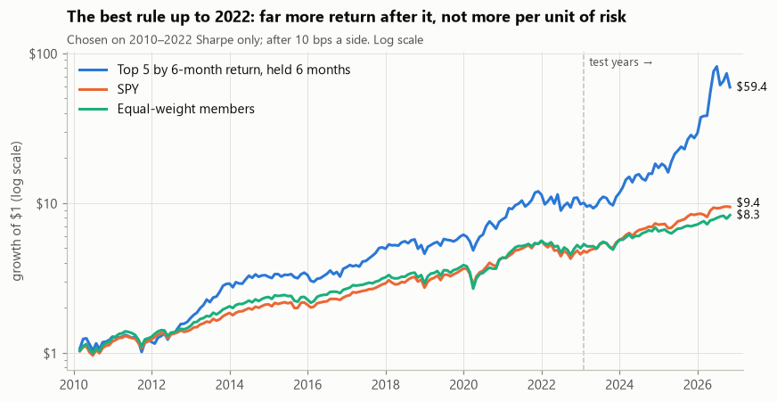
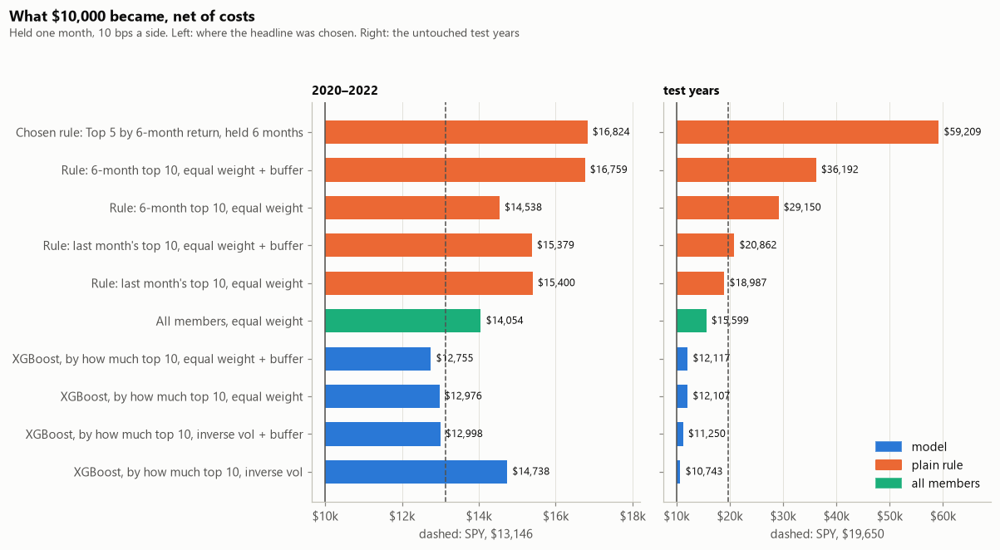

# Chapter 9: Results

## 1. Goal

Answer the two questions from [Chapter 1](01_problem.md): does buying the S&P 500's recent
winners beat simply holding SPY, and can a machine-learning model pick better than "buy what went
up"?

Two kinds of strategy are compared throughout:

- **The plain rule:** each month-end, buy the members that rose the most over a recent period (for
  example the top 10 by 6-month return). No model, just recent winners.
- **The model:** each month-end, buy the members a machine-learning model rates most likely to beat
  SPY (a fund that tracks the S&P 500) next month. Eight models were built; the **headline** is the
  one chosen in advance, before the test years were read ([Chapter 6](06_modelling.md)).

---

## 2. How every strategy was judged

- **The index as it was on each date,** including the companies that later left it.
- **Decide on the month-end close, trade at the next open,** paying 0.1% on every buy and sell.
- **Every choice made on 2010–2022.** Every strategy is then judged on the same untouched test
  years: decisions from January 2023, 45 months.
- **Risk counts.** The Sharpe ratio (return above cash per unit of volatility) and the worst fall
  (the largest drop from a previous peak) sit next to the return.

---

## 3. What came out

### 3.1 Buying recent winners buys more risk

Of 60 versions of the plain rule (how far back "winner" is measured, how many stocks are bought, how
long they're held), over 2010–2026:

| Each version's result, compared with SPY's | Versions, of 60 |
| --- | --- |
| Earned a higher return a year than SPY | 52 |
| Earned more per unit of risk than SPY (a higher Sharpe ratio) | 3 |
| Had a deeper worst fall than SPY | 60 |

In a market that rose for most of these years, more risk was paid for with more return, but not with
more return per unit of risk. Measuring "winner" over 6 months, buying 5 or 10 stocks and holding
longer worked best; buying the single best stock each month worked worst.
([Chapter 7, §3.1–3.2](07_simulation.md#31-more-return-but-more-risk))

### 3.2 The best rule, chosen in advance: three times SPY's yearly return, the same Sharpe ratio

The rule with the best Sharpe ratio on 2010–2022 buys the **top 5 by 6-month return and holds them
6 months**. Followed through the test years:

| Test years | The rule | SPY |
| --- | --- | --- |
| What $10,000 became | **$59,209** | $19,650 |
| Yearly return | 60.7% | 19.7% |
| Volatility | 43.1% | 11.8% |
| Sharpe ratio | 1.21 | 1.21 |
| Worst fall | −27% | −8% |

The chart follows $1 from 2010 on a log scale; the dashed line marks the start of the test years,
where the table above begins.

Most of the gain came from a handful of AI and memory-chip stocks (NVIDIA, Western Digital,
Palantir, Seagate, GE Vernova, SanDisk, Micron), and most of it arrived in one burst in late 2025
and 2026: a market theme the rule caught, not a steady edge.
([Chapter 7, §3.3](07_simulation.md#33-chosen-on-20102022-followed-through-the-test-years)
and [§3.10](07_simulation.md#310-what-the-paths-show))

### 3.3 The headline model lost to the plain rules and to SPY

A random pick beats SPY as often as the average member does: 49.9% of the time on 2020–2022, where
the models were compared, and 45.1% on the test years.

- **On 2020–2022, two of the eight models beat a random pick:** the headline (51.9% of its picks
  beat SPY) and the decision tree (51.4%). So did both plain rules.
- **On the test years, the headline did worse than a random pick:** 43.6%. The neural network
  (51.6%) and logistic regression, both below a random pick on 2020–2022, led the models instead.
- **Traded, the headline trailed SPY in both periods:** $12,976 against $13,146 on 2020–2022.

| Test years, top 10 held one month unless stated | What $10,000 became | Sharpe ratio |
| --- | --- | --- |
| The rule chosen in advance (top 5, held 6 months) | $59,209 | 1.21 |
| 6-month rule | $29,150 | 0.84 |
| SPY | $19,650 | 1.21 |
| Last month's winners | $18,987 | 0.56 |
| All members, equal weight | $15,599 | 0.64 |
| **Headline model** | **$12,107** | **0.12** |

Of 121 simulated strategies (the eight models and the two 1-month rules, each at top 1, 5 and 10 in
four versions, plus the chosen rule), only 3 edged SPY's Sharpe ratio on the test years: the 6-month
rule's single best stock (counted twice: with one stock, two of its versions are the same) and the
chosen rule, which ties. No model did.
([Chapter 6, §3.7–3.8](06_modelling.md#37-the-comparison-on-20202022-two-models-beat-a-random-pick),
[Chapter 7, §3.5–3.7](07_simulation.md#35-the-headline-model-loses-to-the-plain-rules-and-to-spy))

### 3.4 A market-trend filter helped once, and hurt overall

Selling everything whenever SPY closed a month below its 10-month average:

- **Helped on 2020–2022,** which included 2022's long decline: it raised the Sharpe ratio of about
  60% of the strategies, though it lowered SPY's, the chosen rule's and the 6-month rule's.
- **Raised no strategy's Sharpe ratio on the test years.**
- **Hurt over 2010–2026:** filtered SPY earned 7.8% a year against 14.3%. It kept missing the
  rebounds: in the months it was out, SPY rose 3.5% on average, against 0.8% in the others.

([Chapter 7,
§3.9](07_simulation.md#39-the-filter-helped-in-one-long-decline-and-hurt-everywhere-else))

### 3.5 Why the model lost: it never bet on winners

Every pick was ranked against all the members that month, from 0 (the lowest) to 100 (the highest),
and the ranks were averaged over each period (50 = an average member):

| What the picks looked like | How volatile | Return over the past 6 months |
| --- | --- | --- |
| The model, 2020–2022 | 78: among the more volatile | 18: among the weakest |
| The model, test years | 52: average | 52: average |
| The 6-month rule, 2020–2022 | 79 | 99: the very best |
| The 6-month rule, test years | 85 | 99: the very best |

- **The rule bought the recent winners both times.** In the test years 46% of its picks were
  technology stocks, against 14% of members: it rode the AI and chip boom.
- **The model never did, and its bet changed with the market.** On 2020–2022 it bought volatile,
  beaten-down stocks, in effect betting on a rebound. On the test years its picks looked like an
  average member, with no clear bet (technology was 20% of its picks, against 14% of members).
- **A model that reads mostly the market's mood ([Chapter 6](06_modelling.md)) buys a different kind
  of stock as the mood changes.** This describes the picks; it wasn't tested as a cause.

([Chapter 7, §3.11–3.12](07_simulation.md#311-part-4-why-the-model-loses))

### 3.6 The bottom line

**On this data, the model chosen in advance adds nothing that a plain 6-month momentum rule doesn't
already do better, and no strategy chosen in advance clearly beats SPY per unit of risk.**

- **Two models not chosen did better per unit of risk than the 6-month rule on the test years:**
  the neural network and the decision tree (Sharpe ratios 0.97 and 0.92, against 0.84). Nothing seen
  before the test pointed to them, and picking one now would be choosing on the test.
- **The one test still to come is the live record:** the model's and the 6-month rule's picks, made
  each month before their results are known ([Chapter 8](08_automation.md)).

[Chapter 10](10_lessons.md) asks why the models lost and what that means.

---

## 4. Caveats

- **Some early takeovers have no free price at all ([Chapter 3](03_monthly_table.md)).** Takeover
  targets are often recent winners, so the rules' numbers may still be slightly flattered.
- **The test years are few:** 45 months, dominated by one market theme. A different four years
  could tell a different story: with the cut a year earlier, SPY's poor 2022 would make the chosen
  rule win on Sharpe too, which is why the cut was fixed in advance.
- **Costs are a flat 0.1% a side;** taxes and the price impact of large orders aren't modelled
  ([Chapter 7](07_simulation.md)).
- **The chosen rule isn't tracked live.** The live record follows the model and the 6-month rule
  (top 10, held one month), so it compares only how stocks are picked; tracking more rules would
  make it another place to pick a winner from
  ([Chapter 8, §3.2](08_automation.md#32-what-gets-published)). So the chosen rule's result rests on
  the backtest alone.
