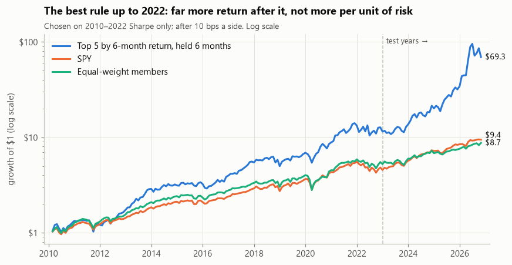
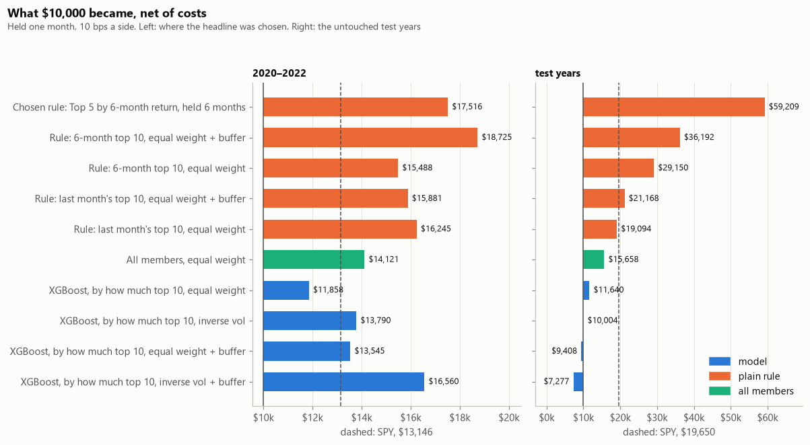

# Chapter 9: Results

## 1. Goal

Answer the two questions from [Chapter 1](01_problem.md): does buying the S&P 500's recent winners beat
simply holding SPY, and can a machine-learning model pick better than "buy what went up"?

Two kinds of strategy are compared throughout:

- **The plain rule:** each month-end, buy the members that rose the most over a recent period (for
  example the top 10 by 6-month return). No model, just recent winners.
- **The model:** each month-end, buy the members a machine-learning model rates most likely to beat
  SPY next month ([Chapter 6](06_modelling.md)).

> **All numbers here are previews.** The download of delisted companies is still running, so the early
> years still miss many acquired companies. Everything gets rerun once it's complete.

---

## 2. How every strategy was judged

- **The index as it was on each date,** including the companies that later left it.
- **Decide on the month-end close, trade at the next open,** paying 0.1% on every buy and sell.
- **Every choice made on 2010–2022.** Every strategy is then judged on the same untouched test years:
  decisions from January 2023, 45 months.
- **Risk counts.** The Sharpe ratio (return above cash per unit of volatility) and the worst fall sit
  next to the return.

---

## 3. What came out

### 3.1 Buying recent winners buys more risk

Of 60 versions of the plain rule (how far back "winner" is measured, how many stocks are bought, how
long they're held), over 2010–2026:

| Each version's result, compared with SPY's | Versions, of 60 |
| --- | --- |
| Earned a higher return a year than SPY | 53 |
| Earned more per unit of risk than SPY (a higher Sharpe ratio) | 7 |
| Had a deeper worst fall than SPY | 60 |

In a market that rose for most of these years, more risk was paid for with more return, but not with
more return per unit of risk. Measuring "winner" over 6 months, buying 5 or 10 stocks and holding
longer worked best; buying the single best stock each month worked worst.
([Chapter 7, §3.1–3.2](07_simulation.md#31-more-return-but-more-risk))

### 3.2 The best rule, chosen in advance, tripled SPY's return but only tied it on risk

The rule with the best Sharpe ratio on 2010–2022 buys the **top 5 by 6-month return and holds them
6 months**. Followed through the test years:

| Test years | The rule | SPY |
| --- | --- | --- |
| What $10,000 became | **$59,209** | $19,650 |
| Yearly return | 60.7% | 19.7% |
| Volatility | 43.1% | 11.8% |
| Sharpe ratio | 1.21 | 1.21 |
| Worst fall | −27% | −8% |

Most of the gain came from a handful of AI and memory-chip stocks (NVIDIA, Western Digital, Palantir,
Seagate, GE Vernova, SanDisk, Micron), and most of it arrived in one burst in late 2025 and 2026: a
market theme the rule caught, not a steady edge.
([Chapter 7, §3.3](07_simulation.md#33-chosen-on-20102022-followed-through-the-test-years))

### 3.3 The models did worse than the plain rules

On 2020–2022, where the models were compared, every model's top 10 beat SPY less often than a random
pick would have, while both plain rules did better. The headline model, chosen there before the test
was read, then did no better than a random pick on the test years.

| Test years, top 10 held one month unless stated | What $10,000 became |
| --- | --- |
| The rule chosen in advance (top 5, held 6 months) | $59,209 |
| 6-month rule | $29,150 |
| SPY | $19,650 |
| Last month's winners | $19,094 |
| All members, equal weight | $15,658 |
| **Headline model** | **$11,640** |

Of 121 simulated strategies, 12 edged SPY's Sharpe ratio on the test years, about what chance gives
among so many related tries, and most of them held a single stock. Of the strategies declared in
advance, only the chosen rule did, and that's a tie.
([Chapter 6](06_modelling.md), [Chapter 7, §3.5–3.7](07_simulation.md#35-the-headline-model-loses-to-spy-and-to-the-plain-rules))

### 3.4 A market-trend filter made things worse

Selling everything whenever SPY closed a month below its 10-month average lowered the Sharpe ratio of
SPY and of every pre-declared strategy, in every period. It kept missing the rebounds: SPY rose 3.5%
on average in the months after the filter got out, against 0.8% in the others. Over 2010–2026,
filtered SPY earned 7.8% a year against 14.3%.
([Chapter 7, §3.9](07_simulation.md#39-the-filter-lowered-risk-adjusted-returns-everywhere))

### 3.5 Why the model lost: it bet on rebounds, not on winners

To see what each strategy really bought, every pick was ranked against all the members that month,
from 0 (the lowest) to 100 (the highest), on two measures, and the ranks were averaged over the test
years:

| What the picks looked like | How volatile (0–100) | Return over the past 6 months (0–100) |
| --- | --- | --- |
| The model's picks | 90: among the most volatile | 20: among the weakest |
| The 6-month rule's picks | 86: among the most volatile | 99: the very best |

Both bought jumpy stocks, but opposite ones. The rule bought the recent winners; the model mostly
bought recent losers, in effect betting they'd bounce back. That bet lost most when the market fell:
in SPY's down months, the model's picks beat SPY only 39% of the time in the test years, against 51%
for all members.
([Chapter 7, §3.12–3.13](07_simulation.md#312-part-4-why-the-model-loses))

### 3.6 The bottom line

**On this data, the models add nothing that a plain 6-month momentum rule doesn't do better, and no
strategy chosen in advance clearly beats SPY per unit of risk.** The one test still to come is the
live record: picks made each month before their results are known
([Chapter 8](08_automation.md)). [Chapter 10](10_lessons.md) asks why the models lost and what that
means.

---

## 4. Caveats

- **Previews only.** Takeover targets are often recent winners, so the rules' numbers are likely to
  change once the missing acquired companies are in.
- **The test years are few:** 45 months, dominated by one market theme. A different four years could
  tell a different story.
- **Costs are a flat 0.1% a side;** taxes and the price impact of large orders aren't modelled
  ([Chapter 7](07_simulation.md)).
